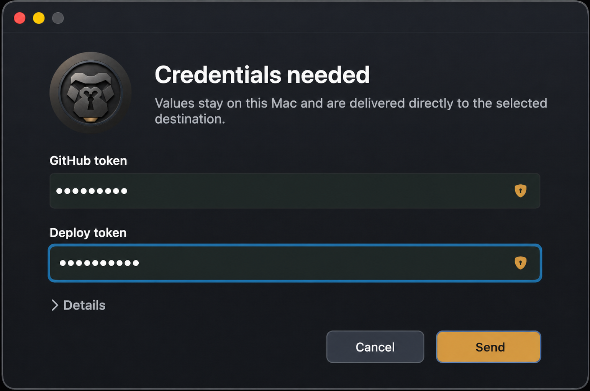

<p align="center">
  
</p>

# KeyKong
Key Kong collects user values in a native macOS prompt, delivers them to
visible local destinations, and keeps secrets out of model context, logs, and
tool responses.

## Usage

Install Key Kong locally:

```sh
bun run install:local
```

Add the agent skill:

```sh
npx skills add . --skill keykong
```

### Web prompt over Tailscale

On a machine you reach over Tailscale, Key Kong can serve its prompt as a web
page instead of the native window:

```sh
keykong prompt web                          # untagged node: allows its owner
keykong prompt web --allow you@example.com  # tagged node
keykong prompt native                       # switch back
```

`keykong prompt web` mounts `https://<node>.<tailnet>.ts.net/keykong` with
`tailscale serve` and accepts submissions only from the allowed Tailscale login.
It needs Tailscale HTTPS and permission to change Serve, for example
`sudo tailscale set --operator=$USER`. Bookmark the URL: while a request waits,
it redirects to that request's page, which `keykong request` also prints to
standard error.

## Development

Install dependencies and run both test suites:

```sh
bun install
```

Run the built CLI with a representative prompt for visual testing:

```sh
bun test:ui -b
```
